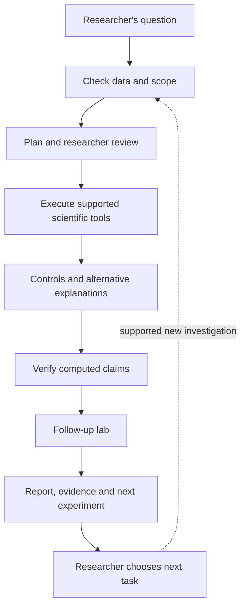

# SpatialScout: co-scientist positioning and a demo anyone can follow

2026-11-04. Proposed product presentation, walkthrough and implementation brief. The current implementation is described separately from proposed changes. This document does not alter canonical GitHub scope, existing ADRs, model recordings or deployed behavior.

## 1. The product we are building

**SpatialScout is a spatial-omics co-scientist powered by Meta models. It helps kidney researchers delegate the work between a question about tissue and a checked, reproducible research lead.**

The broad ambition is to connect large tissue images, gene and protein measurements, scientific tools and literature in a single investigation workspace. The current completed module tests the reliability of unexpected molecular signals, adds separate protein evidence and literature, and produces figures and an evidence package. Present this module as a useful delegated investigation inside the broader platform.

Do not introduce it as Meta's own announced science product. Suggested comparison: **“We are building a specialized counterpart to general AI research workbenches, using Meta's model ecosystem for spatial biology.”**

### What appears at the very start

Title: **SpatialScout**

Headline: **A co-scientist for kidney research**

Support: **Delegate the work of investigating tissue images, molecular signals and supporting evidence.**

Scope line: **Human kidney data. RNA cohort includes diabetic kidney disease (DKD); separate healthy/CKD/AKI protein images.**

Primary action: **Follow an investigation**

Secondary action: **Explore the tissue**

Visible mode: **Recorded investigation** or **Live investigation**, determined by actual mode. Keep this visible on mobile as well as desktop.

The first narrated sentence: “We are building SpatialScout for scientists studying kidney disease, starting with human kidney data that includes diabetic kidney disease.”

### Disease boundaries

The RNA dataset includes DKD, IgAN, MCD, MN and controls. The featured audit pools eligible sections across this kidney cohort; it is not a DKD-specific discovery. The KPMP protein images are from separate participants with healthy reference, CKD or AKI enrollment categories. A generic CKD category does not establish DKD or lupus nephritis (LN). LN is a research expansion requiring an actual LN dataset. Show the broad kidney focus first and the precise source labels beside the evidence.

## 2. The researcher problem, without specialist vocabulary

“A scientist sees an unexpected signal in a kidney sample. Before deciding what to test in the lab, they must work out where the signal comes from, whether the analysis is dependable, whether other evidence agrees and what experiment could resolve the uncertainty.”

Today that task may involve navigating a tissue viewer, preparing counts in code, running controls, consulting another dataset, retrieving papers and assembling a report. The product brings those tasks into a single delegated workflow. This is the effort-reduction claim we can demonstrate now. Hours saved and experimental costs avoided require measurement.

Use this simple visual explanation: **the image is a map; molecular measurements are labels on that map; the co-scientist gathers and checks the evidence for a question.** A cell-border ambiguity is one example that makes the current module concrete, not the platform's entire identity.

### The mission the audience sees

**Investigate an unexpected signal in kidney immune cells.**

Mission summary: “Check whether it survives stricter counting, inspect available protein evidence, read relevant research and prepare the evidence for a follow-up experiment.”

The existing two-part recording supports showing this as a chapter summary of its B-cell UMOD branch, with the podocyte LRP2 branch available as a comparison. It must not be presented as a new broad prompt that was executed if it was not. Keep the original question available under **Exact research question** and load its recording by ID. A newly typed request requires a genuine fresh run and a new unedited recording if it is to become a replay.

## 3. Three-minute walkthrough and narration

Target duration: about three minutes, subject to the actual submission portal requirements. This is a recording plan, not an assertion that the current UI already implements every screen below.

| Time | Screen and action | Narration | What this proves |
| --- | --- | --- | --- |
| 0:00–0:20 | Open on real kidney tissue; name kidney research and DKD RNA cohort; small source labels | “A kidney researcher has tissue images and thousands of cell measurements. An unexpected signal may be worth following up—but first someone has to connect the evidence and test other explanations.” | Domain, user and purpose are understandable immediately. |
| 0:20–0:40 | Show a single mission beside tissue. Open the recorded investigation with its exact question available. | “With SpatialScout, the researcher delegates that investigation. It plans the checks, runs the analysis and brings back evidence they can inspect.” | Task delegation rather than chat alone. |
| 0:40–1:05 | Show the plan and actual executed tasks: RNA analysis, random-loss control, alternate labelling, verifier. Keep tissue large. | “It asks whether the signal remains when counting becomes stricter, whether losing molecules alone explains the change, and whether the result depends on how cells were labelled.” | Real tools and relevant controls. |
| 1:05–1:30 | Show UMOD branch, a region on the RNA map and a simple observed/expected comparison | “In cells labelled as B cells, the signal goes from 17.0% to 12.3%. Random molecule loss alone would predict 9.5%. It survives these checks and deserves closer investigation.” | A concrete result and its bounded meaning. |
| 1:30–1:55 | Open lab. Show the actual parallel task timeline briefly, then separate KPMP protein view and papers | “It checks another kind of evidence too: protein images from different kidney specimens. At the same time, it reads relevant papers and prepares figures. These specimens provide another line of evidence, rather than a matched repeat of the RNA experiment.” | Useful parallel delegation, modality/source honesty. |
| 1:55–2:20 | Open a cited number and verification details; show recorded injected wrong number rejected | “Every cited number can be traced to a computation. Here, a deliberately changed number fails the check. The scientist can inspect the source, figure and method behind each statement.” | Reviewable execution and error detection. |
| 2:20–2:45 | Show the evidence report, remaining explanations, next experiment and package download | “The outcome is a research lead with its limitations, a proposed follow-up experiment, figures and reproducible evidence. The researcher decides what to pursue.” | A useful finished deliverable. |
| 2:45–3:00 | Show sample-data audit and connection choices if implemented; otherwise present local setup/roadmap accurately | “The same audit engine can work on compatible Xenium sections. The broader platform will connect larger images and other molecular assays, with researchers choosing their data and model access.” | Extension path that preserves the working result. |

The first four sentences should work without anyone knowing UMOD, podocytes or transcriptomics. Introduce gene symbols only when they label a result. Avoid forcing the audience to understand both branches of the recorded hypothesis at the start.

### Closing line

**“From kidney tissue to a checked research lead—so the scientist can spend more time choosing the next experiment.”**

### Result wording that stays within the evidence

- Use **Signal persists under tested rules**, **Sensitive to assignment choices**, and **More evidence needed** as the primary human-readable outcomes.
- Preserve existing recorded confirmed/refuted values in the evidence detail, labelled **Prediction check**. Explain that this concerns the tested behavior, not biological truth.
- Replace “UMOD ... is not explained by ... spillover” with **“UMOD signal in labelled B cells persists under the tested assignment restrictions.”**
- Say **research lead** or **candidate to investigate**, rather than new discovery. Zero co-mentions in 50 titles/abstracts does not establish novelty or absence from all literature.
- For LRP2, the observed nucleus-only share is 23.8%, below the 24.4% random-thinning expectation. It passes a tolerance-based frozen rule; a stable label must not be paraphrased as “above expectation.”

## 4. The research harness

The defensible answer to “is this just a wrapper?” is a demonstration of actual execution. Models propose actions; the system binds those actions to scientific data, tools, checks and recorded evidence.



Current loop: the planner and follow-up model choose bounded operations. Deterministic tools compute quantities. After the verdict, Wonder dispatches literature, protein and figure tasks concurrently. The report does not change the frozen investigation's verdict. Proposed future loop: new approved investigations can be launched from gaps in that report. Do not animate unimplemented tool execution or imply the fixed registry is unlimited autonomy.

Useful specialist roles:

| Role shown to scientist | Actual responsibility | Current status |
| --- | --- | --- |
| Data specialist | Check available genes, metadata, assays and file compatibility | Data capability and question-fit checks exist; general multimodal ingestion is future. |
| Spatial analyst | Inspect molecule/cell locations and run assignment checks | Implemented bounded tools. |
| Evidence reviewer | Recompute numerical claims and inspect figures | Implemented; visual reviewer has known false positives. |
| Protein cross-check | Assess available protein-image evidence | Implemented for curated KPMP data; separate specimens. |
| Literature specialist | Fetch and summarize records with citations | Implemented; citation membership checks do not prove semantic entailment. |
| Figure/report specialist | Assemble computed figures and a traceable report | Implemented tools; not a new reasoning model for every job. |
| Neighborhood analyst | Test injury/immune/fibrotic niches across donors | Proposed, requiring richer input and spatial statistics. |

## 5. UI changes to support this explanation

The interface should work as a research workspace. Keep the tissue and evidence visible; make the agent network a concise view of work, not the central object the audience has to understand.

Suggested desktop layout:

```text
SpatialScout    Kidney research / Investigation       Recorded / Live     Connections
Data and runs  | Tissue / figure / comparison         | Evidence inspector
               |                                     | Summary
               |                                     | Inputs and method
               |                                     | Checks
               |                                     | Sources
               |                                     | Reproduce
               | Delegated tasks and actual status    |
               | Ask / narrow / request another check |
```

1. A project scope identifies tissue, disease groups, modalities and sample relationships before a run.
2. A mission card states the question, required inputs and expected deliverable. The same question remains visible through the investigation.
3. The working surface shows the tissue or figure for the selected finding. RNA-rendered views and real protein microscopy always identify their source.
4. The evidence inspector links a selected region, number or claim to inputs, method, check results, citations and export. Distinguish computation provenance from literature citations.
5. A compact task list shows purpose, status, reason for running, output and elapsed time. Each item opens its artifact. The full graph remains an optional detailed view using actual events.
6. A persistent data relationship badge says **Different specimens** for the current RNA/protein comparison. Shared coordinates or overlays require a verified transform and appropriate specimen relationship.
7. On mobile, show Tissue / Tasks / Evidence tabs and keep run mode and source labels visible. Avoid squeezing three desktop panes side by side.
8. Proposed natural-language follow-ups must invoke real supported actions, or explain the missing input/tool. Never attach an inert “Investigate” control to a promised future analysis.

Borrow the useful patterns from Claude Science: a central scientific artifact, versioned provenance and review beside it. Borrow Google's emphasis on alternative ideas and researcher feedback. Borrow AlphaGenome's progression from understandable problem to concrete result and evidence. Do not reproduce branding or imply feature parity.

## 6. Why Meta fits

Wonder coordinates the investigation; Spark handles bounded specialist reasoning, literature and figure interpretation; SAM can supply exploratory geometry; Voice supports spoken delegation; Spark Open supplies a deployable/adaptable option for claim drafting. Glimmer is a potential smaller specialist after task-specific evaluation. These are capabilities offered by the ecosystem, not proof of a scientific performance advantage. [Meta model catalogue](https://dev.meta.ai/docs/models).

The harness keeps model reasoning separate from quantitative measurement. That choice lets a lab adapt routing or deployment while keeping the scientific tool contracts, provenance and evidence checks. Demonstrate this composability and the completed tasks. A real advantage over another model requires a controlled comparison.

For large multichannel TIFFs, the important capability is coordinate-preserving data access: metadata, channels, multiresolution tiles, region retrieval and quantitative execution. Vision models receive selected supported previews and plots. TIFF is not listed as a supported image MIME type in Meta's vision API documentation. A large context window does not replace the image/data pipeline. [Meta image input documentation](https://dev.meta.ai/docs/image-understanding), [OME-NGFF](https://ngff.openmicroscopy.org/latest/).

## 7. Model access and bring-your-own-key

Requested UX: a **Connections** screen with three explicit modes.

| Mode | User promise | Required behavior |
| --- | --- | --- |
| Recorded demo | Explore a completed investigation without spending model credits | Immutable playback with visible recording identity and time. |
| Sponsored live trial | Use our limited model budget while it is available | Show availability, limits, real execution mode and consumed budget. Server keys remain server-side; trial can be disabled without disabling replay. |
| Your model connection | Continue with your own provider account | Explicit provider/model routing and isolated credentials; no silent fallback to sponsored keys. |

Suggested trial copy, **only when enabled**: “This live trial uses our model credits and may be paused when the budget is reached. Your own connection lets you continue using your provider account.” Otherwise show: “Live trial unavailable. Recorded investigations and compatible sample-data audits remain available.” Never promise ongoing free access or a limit that is not enforced.

### Existing code boundary

`LiveGate` currently owns one shared client using server environment keys. The web client does not yet provide a user connection or send a live passcode. A key input alone is insufficient for a multi-user BYOK flow. `Your data` audits currently bypass models and delete temporary files; BYOK must not silently change that data-handling promise.

### Implementation requirements for public BYOK

1. Create a user/session-scoped connection capability with a bounded lifetime and an explicit disconnect action. Bind investigation ownership and every dependent endpoint to that scope before admitting user-funded runs. Keep public demo recordings separately readable.
2. Send keys over TLS to the SpatialScout backend; explain that the backend uses them to call the selected provider. Keep them out of URLs, localStorage, persisted investigations, recordings, audit events, exports and request/error logs. Use memory-only credentials initially, isolated from the global client. An opaque session handle can reconnect the browser without exposing the key in SSE URLs.
3. Validate available models and show a capability summary. A Meta key alone cannot call Spark Open through Baseten. Offer a Meta-only profile with a tested Spark claim-drafting binding, or request separate provider credentials for the full existing profile. The routing change creates a different live configuration and recording identity.
4. Enforce per-run and session budgets, a tool-call limit, cancellation, concurrent-spend reservation and model-specific accounting. Using one's own model key does not pay SpatialScout's compute or storage costs; retain separate resource limits.
5. Do not mix users' caches or responses. Cache identity includes routing/profile and relevant inputs, without storing raw secrets. Never fail over to an undeclared provider or the sponsor account.
6. On expiry/disconnect, stop new calls and define the treatment of in-flight calls. A restarted server loses memory-only connections and asks the researcher to reconnect. Preserve approved results according to the stated retention policy without preserving the credential.
7. Let researchers inspect what would leave the data environment. A future model-enabled upload workflow needs explicit disclosure of selected crops/derived summaries sent to providers; it is separate from today's no-model upload audit.

Meaningful tests: session A cannot retrieve or operate on session B's private investigation; credentials are absent from persistence/logs/errors/exports; expired sessions fail closed; concurrent runs cannot overspend; disconnect disables future calls; replay never invokes a provider; Meta-only routing needs no undeclared provider; secret-shaped provider errors are redacted.

The quickest existing path for a lab to use its own account is a local deployment configured with its own environment keys. Public session-scoped BYOK is an additional feature; do not advertise its button until these boundaries work.

## 8. Evidence that the system reduces effort

Current measured material: the recorded primary investigation reports 179 seconds and estimated model cost of $0.29; the lab has its own recorded wall time and model calls. Keep these phases and replay playback duration separate. These are system measurements, not a measured saving against a human baseline. Sources: `docs/golden-path.md`, the recording's events, and its lab record.

For a small comparison, freeze the same input dataset, question and acceptable report before running either condition. Compare manual workflow and SpatialScout, then use an independent reviewer to check both. Measure hands-on researcher time, end-to-end time, interventions, completed checks, unsupported statements and reproducibility. If a result is not measured before submission, show **tasks delegated** and actual system timing rather than an invented percentage saved.

The current verifier benchmark has limitations: it detects the defined injected errors, but the README also reports valid co-expression claims disputed by the visual check. Present detection together with false positives and scope; do not say the system guarantees correctness.

## 9. Priorities for the next build pass

These are proposed changes for implementation, not published tickets.

| Priority | Change | Acceptance |
| --- | --- | --- |
| First | Reframe intro and first 20 seconds around kidney researcher delegation | A non-specialist can state who it helps and what work it does; disease/source scope is correct. |
| First | Make a guided chapter view of the existing recording | User sees a simple mission summary, original question, real mode, unchanged events and source-linked result. |
| First | Tighten result/candidate wording and surface known limitations | Persistence is not called proof of origin; frozen-rule thresholds are not misstated. |
| First | Make the report/next experiment the demo's destination | Every shown number/source opens; package downloads; no disconnected promise. |
| Next | Keep tissue central and make task graph optional | Task items open their actual artifacts; mobile has readable source/mode labels. |
| Next | Add visible Connections and a correctly gated trial state | Replay/trial/local setup are accurate; no nonfunctional BYOK promise. |
| Next | Public BYOK after session isolation and accounting | Pass the session, leakage, budget, disconnect and routing tests above. |
| Later | General multichannel image ingestion and spatial data model | Supported OME input, validated units/transforms/channels, chunked jobs and recorded QC. |
| Later | Injury-neighborhood and cross-patient research modules, including LN | Appropriate cohort, donor metadata, spatial null models and independent validation. |

The broad platform story and a sharply bounded completed investigation can coexist. Quality comes from making the full task legible and its evidence inspectable, while each new module adds a real capability.

## Further reading

- [Co-scientist research and observed UI patterns](../research/co-scientist-systems-and-demo-patterns-2026-11-04.md)
- [Scientific opportunities, DKD/LN research and data boundaries](../research/spatial-omics-delegation-opportunities-2026-11-04.md)
- [Google Co-Scientist](https://deepmind.google/blog/co-scientist-a-multi-agent-ai-partner-to-accelerate-research/)
- [Claude Science](https://claude.com/product/claude-science)
- [AlphaGenome](https://deepmind.google/science/alphagenome/)
